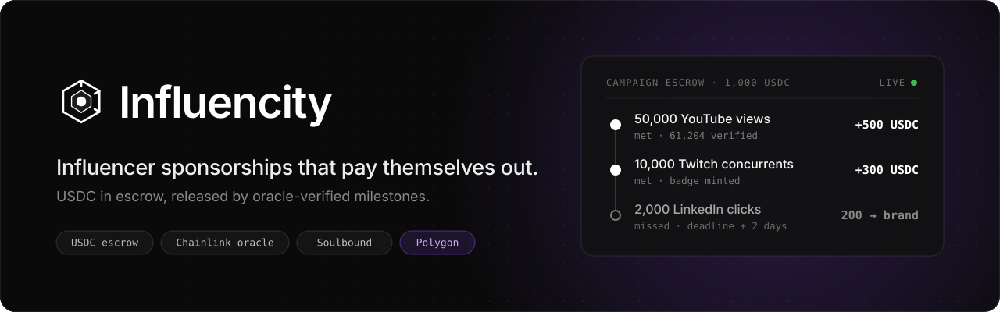
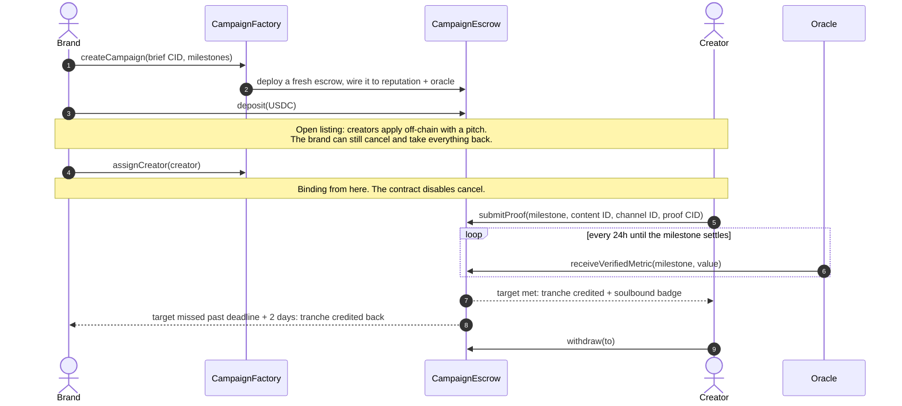
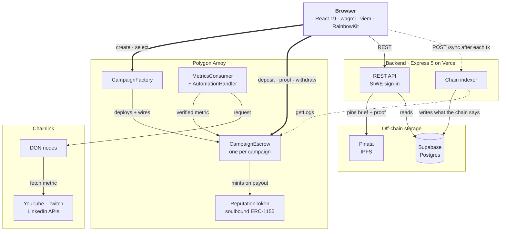

<p align="center">
  <a href="https://influencity-v1.vercel.app">
    
  </a>
</p>

<p align="center">
  <a href="https://influencity-v1.vercel.app"><b>Live app ↗</b></a>
  &nbsp;·&nbsp;
  <a href="#how-it-works">How it works</a>
  &nbsp;·&nbsp;
  <a href="#contracts">Contracts</a>
  &nbsp;·&nbsp;
  <a href="#trust-model">Trust model</a>
  &nbsp;·&nbsp;
  <a href="DOCUMENTATION.md">Technical reference</a>
</p>

<p align="center">
  <a href="contracts/"></a>
  <a href="test/"></a>
  <a href="https://amoy.polygonscan.com/address/0x05CebF15c3CDC9563AC6c40B6141db2dA177Df3B"></a>
  <a href="contracts/oracle/"></a>
  <a href="LICENSE"></a>
</p>

A brand locks USDC against targets anyone can measure, such as *50,000 YouTube views by the 30th*. The creator posts. An oracle reads the real number from the platform, and the escrow pays the creator the moment the target is met. If the target is missed, the money goes back to the brand.

**No one approves a payment, so no one can hold one back.**

> [!NOTE]
> **Testnet only.** It runs on Polygon Amoy with test USDC, which you can mint from the app's dashboard. On Amoy, milestone readings come from a mock oracle. The Chainlink layer is written and tested but not yet deployed. See [Status](#status).

---

## How it works



Each milestone settles on its own. A creator who hits two of three targets is paid for two, and the brand gets the third back.

| Oracle reading | Up to deadline + 2 days | After that |
|---|---|---|
| **At or above target** | ✅ Paid to the creator, badge minted | ✅ Paid to the creator |
| **Below target** | ⏳ Stays pending, checked again next sweep | ↩️ Failed, refunded to the brand |

Proof is due by the deadline. The 2-day grace period only covers a late oracle. After the grace period, anyone can call `finalizeCampaign()`. It fails whatever is still pending and returns unallocated USDC to the brand.

---

## Architecture

**Money and truth live on-chain. Everything else is a cache.**



| Layer | Holds | Can it move USDC? |
|---|---|---|
| **Contracts** | Funds, milestone state, reputation | Yes, but only under the rules below |
| **Backend** | A session-signing key and the database key | **No.** It has no signer and no private key, and only reads the chain |
| **Postgres** | A cache of chain state, plus applications and profiles | No. Every balance and milestone can be rebuilt from chain logs |
| **Browser** | Nothing. The user's wallet signs | Only the user's own transactions |

---

## Contracts

| Contract | Job | Amoy |
|---|---|---|
| `CampaignFactory` | Deploys one escrow per campaign and wires it into reputation, oracle and automation | [`0x05Ce…Df3B`](https://amoy.polygonscan.com/address/0x05CebF15c3CDC9563AC6c40B6141db2dA177Df3B) |
| `CampaignEscrow` | One per campaign. Holds the USDC, settles milestones and pays out by withdrawal | deployed per campaign |
| `ReputationToken` | Soulbound badge per met milestone, plus an on-chain track record | [`0x93d4…F896`](https://amoy.polygonscan.com/address/0x93d4f122681e455F9cc24A27aEcaA2130a25F896) |
| `MetricsConsumer` | Chainlink Functions client and the only address an escrow accepts readings from | built, not deployed |
| `AutomationHandler` | Chainlink upkeep that sweeps live campaigns every 24h | built, not deployed |
| `MilestoneLib` | Milestone struct, supported metrics, deadline and grace logic | library |
| `MockUSDC` | 6-decimal test USDC with a public faucet | [`0x68C6…3BEB`](https://amoy.polygonscan.com/address/0x68C6767ab108690DFab9eff93E5683E4F4EC3BEB) |
| `MockMetricsOracle` | Stands in for `MetricsConsumer` on Amoy. An authorised wallet posts readings | [`0x13F2…3E15`](https://amoy.polygonscan.com/address/0x13F29d51B05AF0d3A3cAB2c6Cf6e949A3cc23E15) |

**What the oracle can measure.** Each campaign has up to 20 milestones. Combinations the oracle can't read are rejected when the campaign is created, so no milestone is unpayable by design.

| Platform | Metrics | Measured on |
|---|---|---|
| YouTube | Views · Subscribers | a video · the creator's channel |
| Twitch | Clip views · Concurrent viewers · Followers | a clip · the creator's channel |
| LinkedIn | Impressions · Clicks | a post by the creator's organisation |

---

## Why it's built this way

**On-chain**

- **One escrow per campaign.** Each deal is its own contract holding only its own money. A bug or a stuck campaign can only affect one brand's funds.
- **Terms can't be edited.** The brief's IPFS CID is a constructor argument with no setter, and the factory adds milestones only at creation.
- **Content is set once.** The creator names the video in `submitProof`, and it can never be changed. A creator can't swap in whichever post happened to do best.
- **Proof of control.** The oracle counts content only from the creator's own channel, and only if that channel's bio contains the creator's wallet address. Nobody can claim someone else's viral video.
- **Pull payments.** Settlement only *credits* balances, and each party collects with `withdraw(to)`. USDC can blacklist addresses, so pushing funds inside the oracle callback would let one blacklisted party freeze the escrow. A blacklisted party can withdraw to another address. The one push, in `cancelCampaign`, goes to the caller.
- **The brand can't settle a campaign ahead of the oracle.** `finalizeCampaign` reverts while any milestone is still live, so a brand can't close a campaign just before a payout lands. Anyone can call it, so a creator can close out an abandoned campaign.
- **The oracle callback never reverts.** A reverting Chainlink callback burns the LINK and loses the reading. Unknown IDs, duplicates, malformed responses and rejected readings are emitted as events instead. One broken milestone can't stall the sweep for other campaigns. The callback gas limit is 500k against a measured 311k for a payout.
- **Reputation can't be bought or faked.** `_update` reverts on anything but a mint, so badges can't be transferred. Token ID = `keccak256(escrow, index)`, so IDs never collide across factory redeploys. `uniqueBrandCount` exposes self-dealing, because each point needs a separate funded brand wallet.
- **Automation is locked to Chainlink.** `performUpkeep` accepts calls only from the Chainlink forwarder, so no one else can drain the LINK subscription. Finished campaigns drop out of the sweep.

**Off-chain**

- **The backend can't touch the money.** It has no signer and no private key. Fully compromising the API leaves every escrow untouched.
- **The database never takes the client's word.** The indexer writes only what chain events say. `/confirm` checks the factory's registry, so a contract built to look like an escrow can't register itself, and `/select` and `/cancel` check on-chain state.
- **Built for Polygon reorgs.** The app waits 3 confirmations on every write, and the indexer stays 5 blocks behind the head.
- **Serverless end to end.** The indexer resumes from a cursor in `sync_state` and re-runs safely. It is triggered after each transaction, plus a daily cron as a backstop. Nothing has to stay running.

---

## Trust model

Brand and creator never have to trust each other. Here's what you do still trust:

- **Whoever controls the oracle script.** The `MetricsConsumer` owner sets the JavaScript the Chainlink nodes run, so that key decides what counts as a view. Node consensus protects against a lying node, not a lying script.
- **On Amoy today, one wallet is the oracle.** `MockMetricsOracle` lets an authorised wallet post any reading.
- **The platforms.** The YouTube, Twitch and LinkedIn APIs are the source of truth.
- **The `ReputationToken` owner** can revoke an escrow's right to mint. Payouts mint in the same transaction, so a revoked escrow can't pay out until it is re-authorised.
- **The factory owner** can repoint USDC, reputation and oracle addresses, but only for campaigns created afterwards. Existing escrows keep the addresses they were deployed with.

Before mainnet, these admin keys would go behind a multisig and a timelock.

---

## Status

| | |
|---|---|
| ✅ **Live on Amoy** | Create → fund → apply → select → submit proof → settle → withdraw, plus cancel. Test-USDC faucet on the dashboard |
| ✅ **Backend live** | SIWE sign-in, chain indexer with a daily cron, database read-only to the public (row-level security) |
| 🧪 **Built, not deployed** | `MetricsConsumer`, `AutomationHandler` and the three platform scripts. `npm run deploy:oracle` deploys and wires them. They are tested against a mock Chainlink router, and the scripts only against faked API responses |
| ⏳ **Not yet** | Badge metadata, so wallets show badges without art |

Each escrow keeps the oracle it was deployed with, so campaigns created before the Chainlink switch stay on the mock. Mainnet is not planned. This is a testnet portfolio deployment.

---

## Tests

**191 passing, 0 failing.** Run them with `npm test`.

| Suite | Tests | Proves |
|---|---:|---|
| `CampaignEscrow` | 73 | deposits, proof, payouts, withdrawals, grace window, blacklisted parties, cancel, safe finalization |
| `ReputationToken` | 30 | soulbound transfers, collision-free IDs, value- and brand-weighted reputation |
| `CampaignFactory` | 27 | creation, wiring, creator assignment, input validation |
| `AutomationHandler` | 23 | enrolment, sweeps, failure isolation, forwarder gate, manual override |
| `MetricsConsumer` | 17 | request routing, oracle arguments, a callback that never reverts |
| `OracleFlow` | 14 | a full campaign through the mock oracle |
| `OracleWiring` | 7 | the production wiring end to end against a mock Chainlink router |

The failure paths are tested with mocks built to fail. `MockFunctionsRouter` drives the Chainlink callback without a live network. `MockMetricsConsumer` reverts on demand, to prove one bad request can't abort a sweep. `MockBlacklistUSDC` blacklists a party mid-campaign.

---

## Run it

```bash
npm install && npm test          # compile + 191 tests
npm run build:abis               # export ABIs to server/src/abis

# deploy core contracts to Amoy (pin gas, see below)
AMOY_GAS_PRICE_GWEI=25 npx hardhat run scripts/deploy.js --network polygonAmoy

(cd server && npm install && npm run dev)    # API  → http://localhost:3001
(cd client && npm install && npm run dev)    # app  → http://localhost:5173
```

<details>
<summary><b>Setup checklist</b></summary>

<br>

- Copy `.env.example` → `.env` and `client/.env.example` → `client/.env.local`. Paste the addresses `deploy.js` prints into both.
- Run `supabase/migrations/001` → `004` in order in the Supabase SQL editor. They are idempotent.
- `SUPABASE_SERVICE_KEY` must be the **service-role** key. Migration 004 blocks writes from every other key.
- `SESSION_SECRET` must be at least 32 characters, or the server refuses to start a session.
- `SIWE_ALLOWED_DOMAINS` lists the hosts allowed to sign in.
- `INDEXER_START_BLOCK` is the block the factory was deployed in. The indexer starts there.

</details>

<details>
<summary><b>Walk the full flow with two wallets</b></summary>

<br>

Both wallets need a little Amoy POL for gas ([faucet.polygon.technology](https://faucet.polygon.technology)).

1. **Brand wallet:** Dashboard → mint test USDC → create a campaign and fund it.
2. **Creator wallet:** Browse → open the campaign → apply.
3. **Brand wallet:** pick the creator. The agreement is now binding.
4. **Creator wallet:** submit proof (content ID + channel ID).
5. **Oracle wallet:** call `MockMetricsOracle.submitMetric(escrow, 0, 75000)` on PolygonScan.
6. **Creator wallet:** "USDC ready to withdraw" → Withdraw. The badge shows on the creator's profile.

</details>

<details>
<summary><b>API</b></summary>

<br>

| Route | Auth | What it does |
|---|---|---|
| `POST /auth/nonce` · `POST /auth/verify` | | SIWE sign-in. The nonce is single-use with a 10-minute TTL, and domain and chain are checked. Returns a 12-hour session token |
| `POST /campaigns` | brand | Pins the brief to IPFS and returns contract params |
| `POST /campaigns/confirm` | brand | Records a campaign after checking the factory's registry |
| `GET /campaigns/open` · `GET /campaigns/:id` | | Marketplace and campaign detail |
| `POST /campaigns/:id/apply` | creator | Applies with a pitch and social links |
| `POST /campaigns/:id/select` · `/cancel` | brand | Records the action after verifying it on-chain |
| `POST /campaigns/:id/proof` | creator | Pins the proof record to IPFS |
| `GET /creators/:address` · `/campaigns` · `/reputation` · `/applications` | | Profile, campaigns, on-chain reputation, applications |
| `GET\|POST /sync` | | Runs the indexer. Public, because it only writes what the chain says |

</details>

<details>
<summary><b>Gotchas that will cost you an afternoon</b></summary>

<br>

- **The official Amoy RPC is dead.** `rpc-amoy.polygon.technology` doesn't respond, and a wallet pointed at it shows a zero balance. Use `https://polygon-amoy-bor-rpc.publicnode.com`.
- **Amoy's suggested gas price spikes to 450+ gwei** against a ~25 gwei floor, which quotes a 0.17 POL deploy at 3 POL. `AMOY_GAS_PRICE_GWEI` pins it.
- **Wrong or stale addresses don't throw an error.** A call to an address with no code succeeds on the EVM. Leave an address blank rather than stale, and let `NetworkGuard` block the wrong chain.

</details>

---

## Repo map

```
contracts/
  core/        CampaignFactory · CampaignEscrow · ReputationToken
  oracle/      MetricsConsumer · AutomationHandler
  libraries/   MilestoneLib
  mocks/       MockUSDC · MockMetricsOracle · MockFunctionsRouter · MockBlacklistUSDC …
scripts/       deploy · deployOracle · verify · exportAbis · seedTestData
test/          7 suites · 191 tests
server/        Express API as one Vercel function · indexer · Chainlink Functions scripts
client/        React app: pages · hooks · wallet guards · testnet faucet
supabase/      migrations 001–004
```

**Stack:** Solidity 0.8.24 · Hardhat 3 · OpenZeppelin 5 · Chainlink Functions + Automation · Express 5 · ethers 6 · Supabase · Pinata · React 19 · Vite 8 · wagmi 2 · viem · RainbowKit · TanStack Query · Tailwind 4 · shadcn/ui · Vercel

---

<p align="center">
  <sub>Built by <a href="https://github.com/gokulakrishnanjawahar">Gokulakrishnan Jawahar</a> · MIT licensed</sub>
</p>
